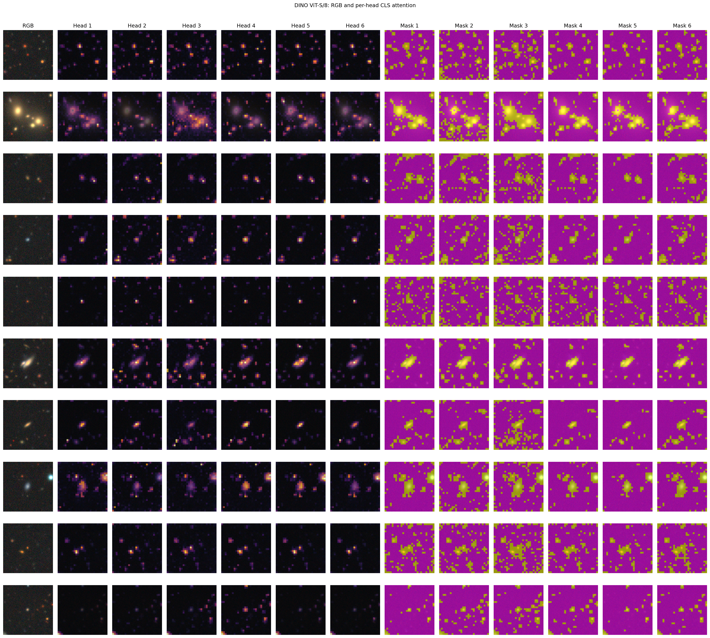
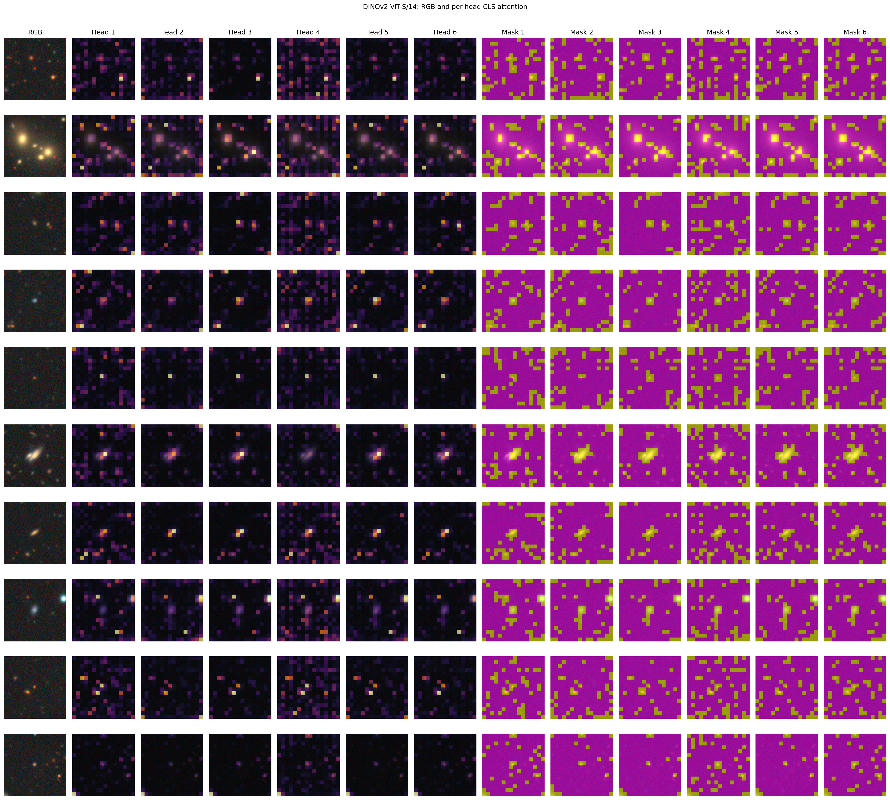
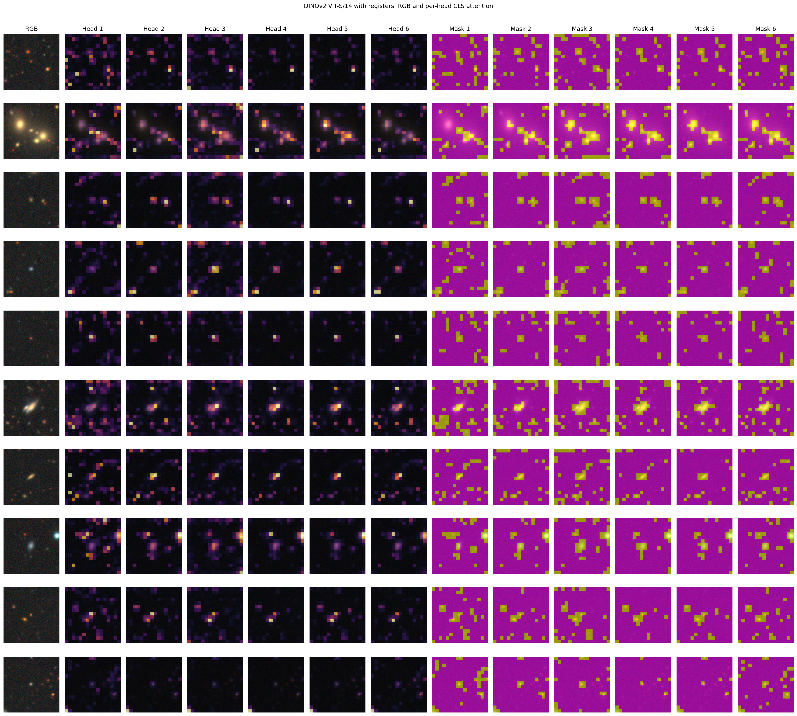
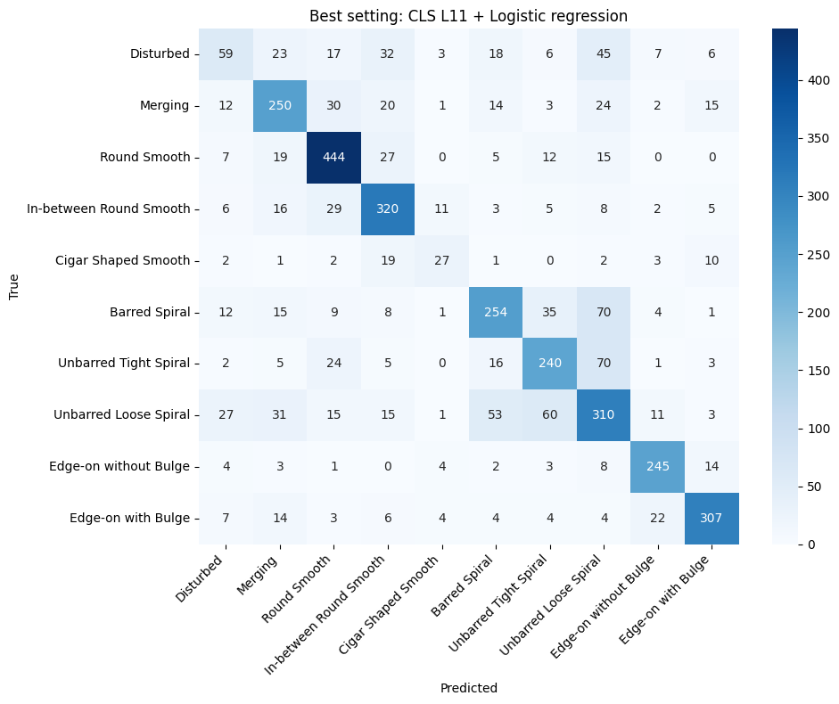
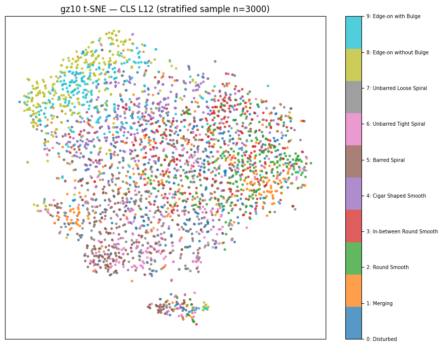
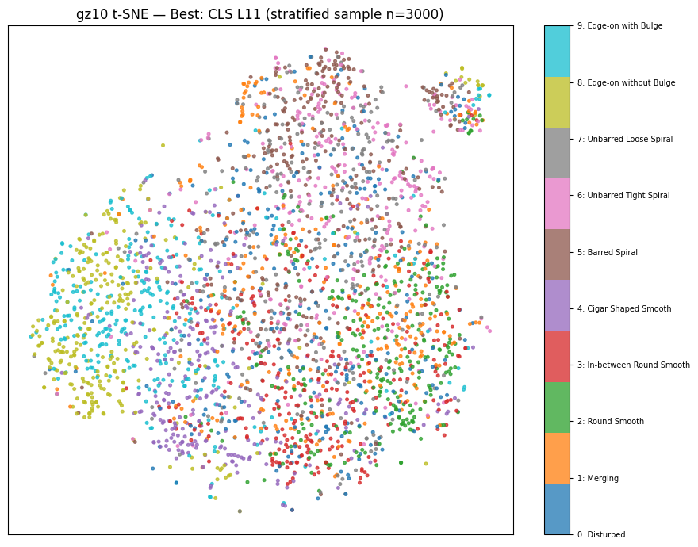

# Week 3 Report: DINOv2 Representations and Attention on DESI

## Aim

This week examines whether pretrained DINO/DINOv2 features capture galaxy morphology and whether class-token attention provides a useful zero-shot segmentation cue. The work reproduces the qualitative attention experiment and quantitative Galaxy Zoo 10 (gz10) probe described in Sections 5.1-5.2 of the AstroDINO assignment.

## Background

- **DINOv2 training:** The recipe adds masked image modeling (MIM, following iBOT), which trains the student to predict teacher features for masked patches. This encourages patch-level features useful for dense tasks. It also uses a KoLeo regularizer to spread features across a batch, Sinkhorn-Knopp teacher centering, and training on LVD-142M followed by distillation from ViT-g to smaller models.
- **Attention maps:** Each final-block attention head assigns weights from the CLS token to image patches. Reshaping the weights gives a spatial map of what contributes to the image representation. This is a saliency visualization, not a trained segmentation output.
- **Registers:** DINOv2 register tokens add learned slots for global information that can otherwise appear as anomalously high-activation background patches. The experiment compares the register and non-register ViT-S/14 models on the same images.
- **Linear probing:** A frozen representation is evaluated with logistic regression. Its accuracy measures how separable the labels are in feature space. The MLP provides a nonlinear comparison.

## Task A: Attention maps and naive masks

### Method

Ten DESI cutouts were processed as RGB images at 224 x 224 with ImageNet normalization. DINO ViT-S/8 returned attention shaped `(10, 6, 785, 785)`: ten images, six heads, 784 patches and one CLS token. The CLS row with its CLS column removed was reshaped to a 28 x 28 map per head and upsampled to 224 x 224. For each head, the naive binary mask keeps the smallest descending-ranked set of patches whose attention sum reaches 60%.

DINOv2 ViT-S/14 returned `(10, 6, 257, 257)` attention (CLS plus 256 patches). The register model returned `(10, 6, 261, 261)` (CLS, four registers, and 256 patches). Register tokens were excluded from the patch maps. Attention was reconstructed from the final block's qkv projection.

### Results

The ten-image contact sheet contains point-like bright sources, multi-source cutouts, and diffuse or elongated galaxy-like objects. The images were sampled from the stream and were not independently labeled by morphology, so observations below are qualitative for this sample.

**DINO ViT-S/8:** Maps generally emphasize bright cores or compact sources. Heads differ in how much surrounding structure and off-center sources they include, but multiple heads can respond to more than one bright object in a cutout. On some elongated galaxy-like examples, attention follows the bright central/elongated structure; faint outer regions receive less consistent coverage.

**Naive masks:** The 60% masks are visibly patchy and often include separated background patches. Some capture the bright center of an extended object, but they frequently omit faint outskirts and do not form a complete contiguous galaxy region. They are useful as a qualitative cue, not as galaxy segmentation masks.

**DINOv2 with and without registers:** The maps from both models contain patch-level hotspots and can emphasize several bright sources. The saved peak-mass statistic does not show reduced peakiness for this run's register model:

| Model | Register tokens | Mean maximum patch mass | Median maximum patch mass |
|---|---:|---:|---:|
| DINOv2 ViT-S/14 | 0 | 0.0710 | 0.0596 |
| DINOv2 ViT-S/14 with registers | 4 | 0.0916 | 0.0736 |

In this sample, the maximum patch's fraction of CLS-to-patch attention mass is higher with registers (about 28.9% higher by the mean). This statistic measures concentration on the single most-attended image patch; it is not a direct measure of background artifact count or segmentation quality. The figures do not support claiming that registers reduced peakiness here.

### Attention figures

**DINO ViT-S/8: RGB, six head maps, and six 60% masks**

**DINOv2 ViT-S/14 without registers**

**DINOv2 ViT-S/14 with four registers**

### Attention-map interpretation checklist

- **Target galaxy or every bright source?** Compare the bright peaks in each head with the RGB row. Note when a foreground star, blend, or unrelated source is also highlighted. These maps show that attention can be distributed among multiple bright sources; it is not constrained to isolate one galaxy.
- **Full galaxy or bright core?** Check whether the map reaches the faint disk/outer envelope. In the displayed examples, bright cores are more consistently emphasized than faint outskirts.
- **Head specialization:** Compare all six heads for each image. Some heads are more localized; others include nearby or off-center bright structures. Heads do not consistently correspond to separate physical objects.
- **Mask quality:** Check connectivity, missed outskirts, and selected background patches. The 60% mass rule often produces fragmented masks in this sample and cannot be treated as segmentation ground truth.
- **Register effect:** Compare the same RGB rows in the two DINOv2 panels. Use the numeric peak-mass summary as a concentration statistic only; the result here is higher for the register model, so the run does not demonstrate reduced peakiness.

## Task B: Layer-wise features and Galaxy Zoo 10 probe

The run used the full gz10 set (17,736 images and ten classes), with a stratified 80/20 split: 14,188 training examples and 3,548 test examples (seed 42). Features were standardized using training data only. The evaluated sets were CLS L9, L10, L11, and L12; mean-patch L12; and concatenated CLS L9-L12. Each was tested with logistic regression and a one-hidden-layer MLP (256 ReLU units, Adam, 30 epochs, batch size 64).

### Class distribution

| Class | Count | Share |
|---|---:|---:|
| Disturbed | 1,081 | 6.09% |
| Merging | 1,853 | 10.45% |
| Round Smooth | 2,645 | 14.91% |
| In-between Round Smooth | 2,027 | 11.43% |
| Cigar Shaped Smooth | 334 | 1.88% |
| Barred Spiral | 2,043 | 11.52% |
| Unbarred Tight Spiral | 1,829 | 10.31% |
| Unbarred Loose Spiral | 2,628 | 14.82% |
| Edge-on without Bulge | 1,423 | 8.02% |
| Edge-on with Bulge | 1,873 | 10.56% |

### Probe results

| Feature set | Probe | Test accuracy | Macro-F1 |
|---|---|---:|---:|
| CLS L11 | Logistic regression | **69.222%** | 65.607% |
| CLS L12 | Logistic regression | 68.968% | 65.860% |
| Concat CLS L9-L12 | MLP | 68.828% | **66.438%** |
| Concat CLS L9-L12 | Logistic regression | 68.799% | 65.271% |
| CLS L10 | Logistic regression | 67.475% | 64.130% |
| CLS L9 | Logistic regression | 67.334% | 63.462% |
| CLS L11 | MLP | 66.488% | 63.506% |
| Mean-patch L12 | Logistic regression | 66.263% | 63.079% |
| CLS L12 | MLP | 65.840% | 63.877% |
| CLS L9 | MLP | 64.797% | 62.083% |
| CLS L10 | MLP | 63.585% | 59.728% |
| Mean-patch L12 | MLP | 62.965% | 60.585% |

The highest accuracy came from the L11 CLS logistic probe (69.222%). The highest macro-F1 came from the concatenated L9-L12 CLS MLP (66.438%), which is useful given the class imbalance. L11 is the best single CLS layer by accuracy; L12 is close behind. Mean-pooling L12 patches did not outperform L12 CLS for either probe. The majority-class baseline is about 14.9%, well below the learned probes.

The paper references 67% for ViT-S/14 and 73% for ViT-L/14 using an MLP on CLS embeddings. The directly comparable setting in this run is the L12 CLS MLP at 65.840%, 1.16 percentage points below the 67% reference. The best overall score (L11 CLS logistic regression) is not a like-for-like comparison to that MLP benchmark. Split and evaluation details may also differ.

### Confusions and per-class results

The best-setting confusion matrix shows spiral subtypes are frequently mixed: Barred Spiral is predicted as Unbarred Loose Spiral 70 times; Unbarred Tight Spiral is predicted as Unbarred Loose Spiral 70 times; Unbarred Loose Spiral is predicted as Unbarred Tight Spiral 60 times and Barred Spiral 53 times. These classes share visual structure, while bar visibility and arm tightness can be subtle. The low-count Cigar Shaped Smooth class (334 examples) and Disturbed class are also difficult: their recalls are 40.3% and 27.3%, respectively. Edge-on classes are the strongest, with recalls of 86.3% (without bulge) and 81.9% (with bulge).

| Class | Per-class accuracy (recall) |
|---|---:|
| Disturbed | 27.3% |
| Merging | 67.4% |
| Round Smooth | 83.9% |
| In-between Round Smooth | 79.0% |
| Cigar Shaped Smooth | 40.3% |
| Barred Spiral | 62.1% |
| Unbarred Tight Spiral | 65.6% |
| Unbarred Loose Spiral | 58.9% |
| Edge-on without Bulge | 86.3% |
| Edge-on with Bulge | 81.9% |

### t-SNE

Both 3,000-example stratified t-SNE plots show some local grouping but substantial overlap among morphology classes. The L11 best-accuracy embedding has visibly distinct regions for some edge-on examples, while spiral categories still intermingle. t-SNE is a qualitative projection and should not be interpreted as a quantitative clustering score.

## Answers to the report questions

1. **Does attention isolate the main galaxy, or every bright source?** In the displayed sample, attention often emphasizes the bright galaxy core, but also responds to other compact bright sources in the cutout. It does not reliably isolate a single galaxy.
2. **Does naive thresholding produce usable galaxy masks? Where does it fail?** The 60% masks are rough saliency regions. In the displayed sample they are often fragmented, may include unrelated background patches, and miss faint outskirts. They are not reliable standalone galaxy masks.
3. **Which layer or combination represents galaxy morphology best?** L11 CLS gives the highest accuracy with logistic regression (69.222%). The concatenated L9-L12 CLS MLP gives the highest macro-F1 (66.438%).
4. **Which classes get confused, and why?** Spiral types are often mixed, especially Barred/Tight/Loose Spiral pairs. The rare Cigar Shaped Smooth and Disturbed classes have low recall, consistent with limited examples and ambiguous visual morphology.
5. **How well do natural-image features transfer to astronomy?** Transfer is useful: the best held-out accuracy is 69.222%, far above the 14.9% majority-class baseline. The L12 CLS MLP reaches 65.840%, modestly below the assignment's 67% ViT-S reference. Differences in split and evaluation mean the comparison is approximate.

## References

- Manwadkar and Kapare, AstroDINO, Sections 3-5 (assignment reference).
- DINOv2 paper: <https://arxiv.org/abs/2304.07193>
- Vision Transformers Need Registers: <https://arxiv.org/abs/2309.16588>
- DINO attention reference: <https://github.com/facebookresearch/dino>
- Galaxy Zoo 10 dataset: <https://huggingface.co/datasets/MultimodalUniverse/gz10>
